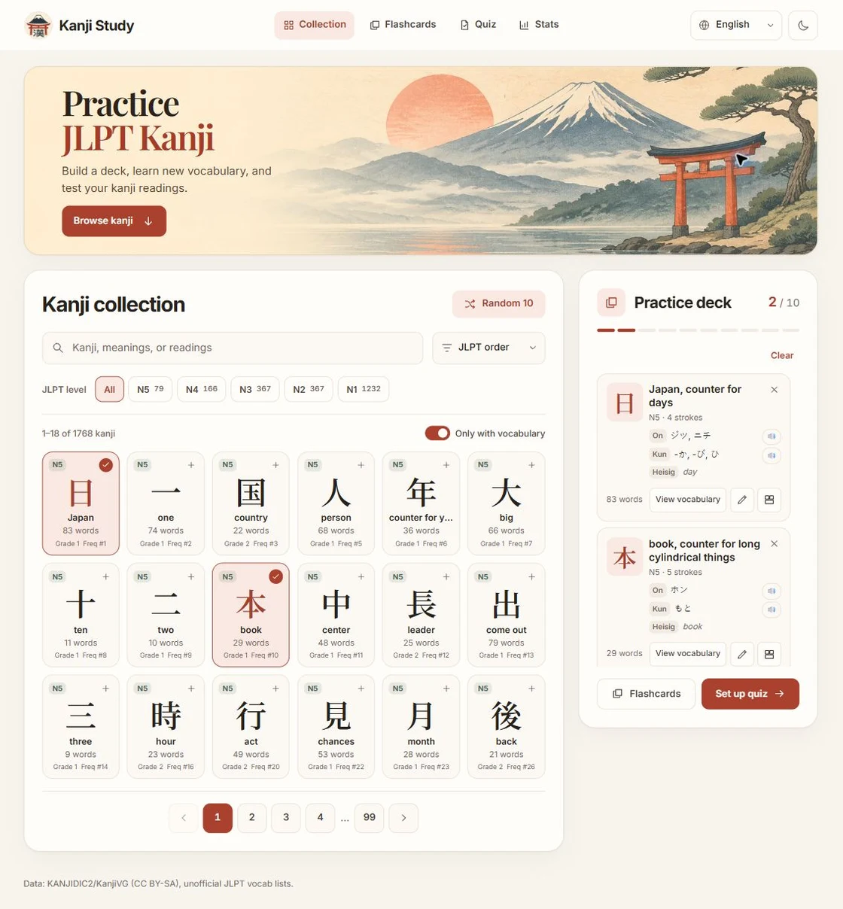

<div align="center">
  
  <h1>Kanji Study</h1>
  <p>Build JLPT study decks, review kanji with flashcards, and practice reading Japanese sentences with Claude.</p>
  <p>
    <a href="https://github.com/mdaninas/Kanji-JLPT-Practice/actions/workflows/ci.yml"></a>
    
    
    <a href="LICENSE"></a>
  </p>
  <p>
    <a href="#features">Features</a> ·
    <a href="#quick-start">Quick start</a> ·
    <a href="#claude-models">Claude models</a> ·
    <a href="#deployment">Deployment</a>
  </p>
</div>



## Features

- Browse the collection by JLPT level in pages of up to 18 cards. Search by kanji, meaning, or reading.
- Build a deck of up to 10 kanji and draw vocabulary with optional JLPT level preferences.
- Practice with flashcards, Japanese audio, stroke order animations, and character breakdowns from KanjiVG.
- Generate up to 10 contextual reading questions with Claude.
- Review kanji with spaced repetition, see daily statistics, and export or import progress as JSON.
- Switch the interface and study meanings between English, Indonesian, Simplified Chinese, Tagalog, and Vietnamese. Choose a light or dark theme and install it as a progressive web app.

The collection covers **2,211 kanji** across JLPT N5–N1, with **7,307 vocabulary entries per language**. Vocabulary is available for **1,768 kanji**.

## Quick start

Use Node.js 20.19 or later in the 20.x series, or Node.js 22.12 or later.

### Run the study interface

```bash
npm ci
npm run dev
```

Open [http://127.0.0.1:5173](http://127.0.0.1:5173) to browse kanji and start a deck.

### Enable Claude quizzes

Copy the environment template in a second terminal.

```bash
cp .env.example .env
```

Set `ANTHROPIC_API_KEY` in `.env` and start the quiz API.

```bash
npm run api
```

## Claude models

| Model | Claude API ID | Previous ID |
| --- | --- | --- |
| Sonnet 5.5 (default) | `claude-sonnet-5-5` | `claude-sonnet-4-6` |
| Opus 5.5 | `claude-opus-5-5` | `claude-opus-4-7` |
| Haiku 5.5 | `claude-haiku-5-5` | `claude-haiku-4-5-20251001` |

Saved selections and environment settings that use a previous ID resolve to the corresponding model in the same family. [Anthropic model reference](https://platform.claude.com/docs/en/models/overview)

## Configuration

| Variable | Default | Purpose |
| --- | --- | --- |
| `ANTHROPIC_API_KEY` | — | Required for quiz generation |
| `ANTHROPIC_MODEL` | `claude-sonnet-5-5` | Default model for API requests without a model selection |
| `ALLOWED_MODELS` | All supported models | Comma-separated list of models the API can select |
| `APP_ORIGIN` | `http://127.0.0.1:5173` | Allowed origin for cross-origin requests |
| `HOST` | `127.0.0.1` | Local API host |
| `PORT` | `8787` | Local API port |
| `UPSTASH_REDIS_REST_URL` | — | Redis URL required for Vercel quiz rate limiting |
| `UPSTASH_REDIS_REST_TOKEN` | — | Redis token required for Vercel quiz rate limiting |
| `QUIZ_DAILY_LIMIT` | `300` | Global daily quiz request limit when using Upstash |

The quiz API allows 10 requests per minute per IP. Local development uses an in-memory limiter when Upstash credentials are omitted.

## Architecture

React 19 and Vite 7 provide the study interface. The Hono endpoint at `/api/generate-reading-quiz` sends selected vocabulary to Claude and validates the response before returning the quiz. Vite proxies local API requests to `http://127.0.0.1:8787`.

```text
api/                 Vercel serverless entry point
server/              Quiz API, validation, and rate limiting
src/                 React components, hooks, styles, and quiz model settings
public/              App icons, image assets, and service worker
Data/                Kanji JSON and vocabulary CSV files by language
Preprocessing/       Optional data preparation notebook
docs/                README preview image
```

## Deployment

Vercel builds the frontend into `dist/` and serves it alongside the API from the same origin. Set the Anthropic API key and both Upstash variables in the Vercel project environment to enable quizzes. [Vercel configuration](vercel.json)

## Development

| Command | Purpose |
| --- | --- |
| `npm test` | Run the Vitest suite |
| `npm run lint` | Check the source and scripts with ESLint |
| `npm run data:validate` | Validate the kanji and vocabulary datasets |
| `npm run build` | Build the frontend for production |

The optional Python preprocessing notebook uses the repository’s Conda environment. [Environment file](environment.yml)

## Troubleshooting

| Symptom | What to check |
| --- | --- |
| Quiz generation fails locally | Start `npm run api` and confirm `.env` contains a valid Anthropic API key. |
| The quiz API returns HTTP 429 | Wait for the time in the `Retry-After` response header. |
| Quiz generation fails on Vercel | Check the Anthropic and Upstash environment variables and review the function logs. |
| Vocabulary appears in a different language | Check the language folders under `Data/Vocabulary/`. The parser reads the word, reading, and translation columns by position. |
| The Vercel build fails on an import | Match the exact capitalization of the imported filename. |

## License

The project code is released under the [MIT License](LICENSE).

The Simplified Chinese meanings use JMdict and KANJIDIC2 translations from Tomoshi (Y1Z). The Chinese data is distributed under CC BY-SA 4.0. [Source, license, and update instructions](public/chinese-data-notice.txt)

Tagalog and Vietnamese meanings are generated from the English study data with Argos Translate and include manually reviewed corrections. [Sources, license, and regeneration instructions](public/tagalog-vietnamese-data-notice.txt)

## Author

Muhammad Dani Nasution

- [LinkedIn](https://www.linkedin.com/in/muhammad-dani-nasution)
- [Instagram (@danasty29)](https://www.instagram.com/danasty29)
